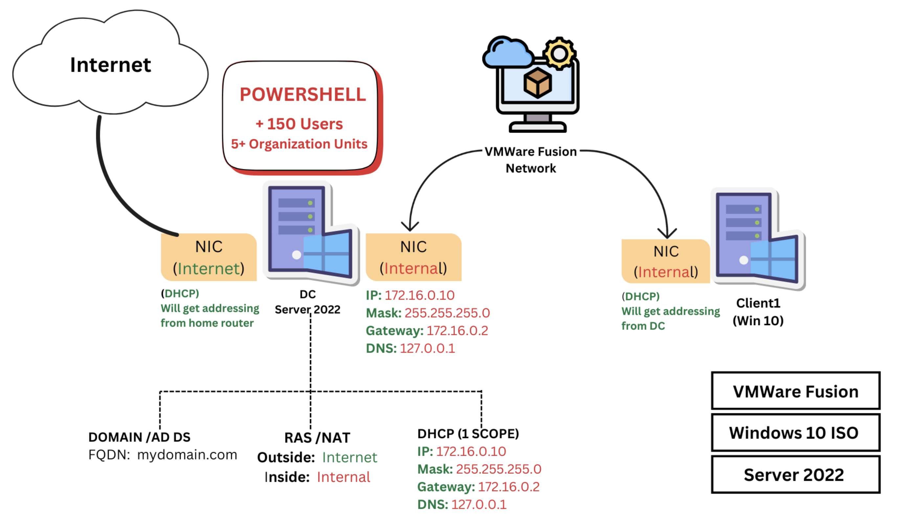
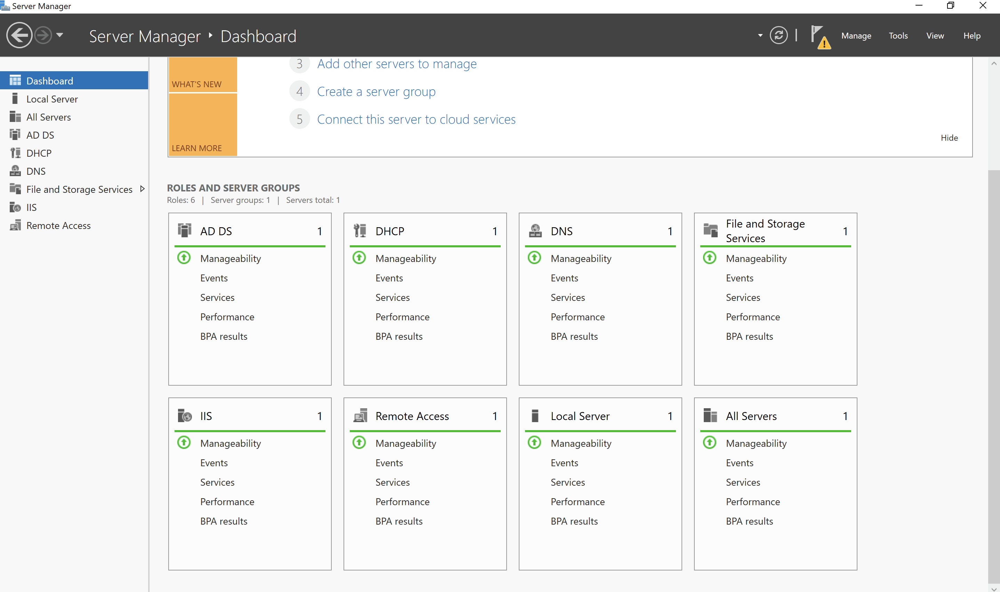
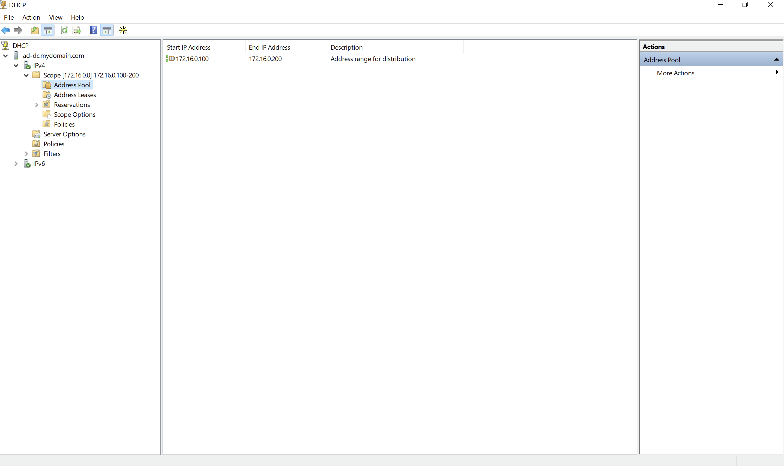
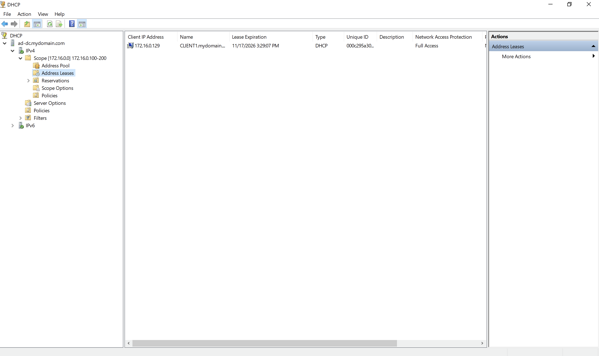
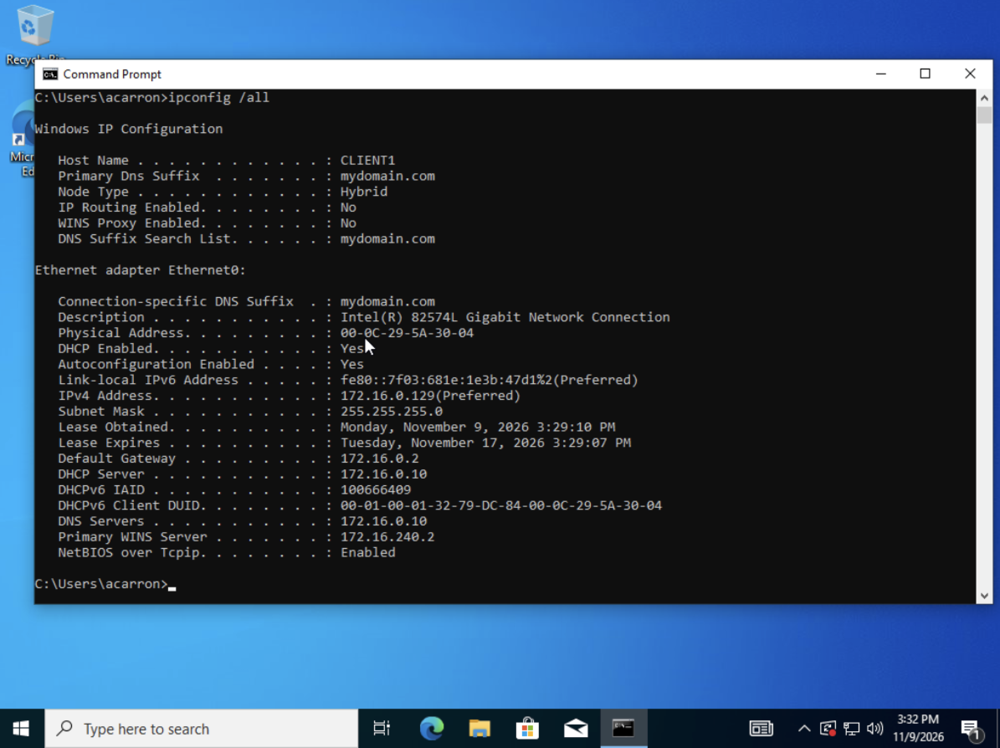
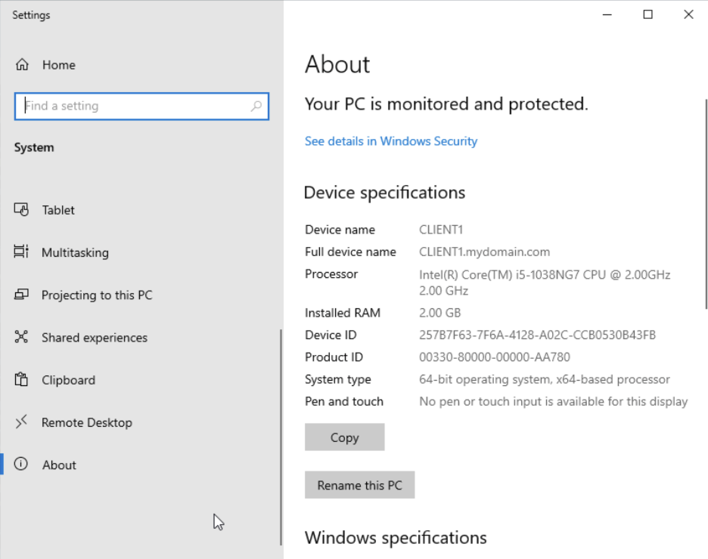

# Active Directory Home Lab - Windows Server 2022

A Windows domain environment built using VMware Fusion. A Windows Server 2022 domain controller runs Active Directory, DHCP, DNS, and RAS/NAT, and a Windows 10 client is joined to the domain. 150 user accounts across multiple Organizational Units were provisioned automatically with PowerShell.

# Architecture

- Domain Controller - Windows Server 2022 (dual-homed): one NIC to the internet, one NIC to the private lab network.
- Client1 - Windows 10: single NIC on the private lab network, joined to the domain.
- Both VMs run in VMware Fusion on a custom internal network (172.16.0.0/24).

# Tech Stack
- Windows Server 2022
- Windows 10
- Active Directory Domain Services
- DNS
- DHCP
- Routing and Remote Access (RAS/NAT)
- PowerShell
- VMware Fusion

# What I built
- Promoted a server to a domain controller and created the domain mydomain.com (AD DS + DNS).
- Configured DHCP with a scope on 172.16.0.0/24 to automatically address clients.
- Set up RAS/NAT so the client reaches the internet through the domain controller.
- Provisioned 150 users across 5+ Organizational Units with a PowerShell script reading from a CSV.
- Joined a Windows 10 client to the domain and logged in with domain credentials.

# Key Concepts Demonstrated
- Active Directory Domain Services — the directory of users, groups, and computers for the domain.
- DNS in AD — the Domain Controller is the DNS server; clients must point to it to find the domain.
- DHCP — automatic IP assignment with a single scope.
- RAS/NAT — the Domain Controller routes and shares internet from its external NIC to the internal network.
- PowerShell automation - account and Organizational Unit creation from a CSV.
- Domain join — moving a client from a workgroup into centralized management.

# Troubleshooting
- Host disk full mid-install — the Mac ran out of space while creating the client VM. Freed space by removing unused ISOs and a redundant VM.
- Installer boot loop — after each reboot the VM booted from the attached ISO and restarted Windows Setup. Fixed by disconnecting the ISO so the VM booted from its installed disk.
- Client isolated from the DC — using VMware's NAT gave the client internet but put it on a different network than the DC resulting to "destination host unreachable" when pinged. Fixed by moving the client onto the same custom VMware network as the DC.
- Domain name wouldn't resolve — the client could ping the DC by IP but not by name. Root cause: the client's DNS wasn't pointing at the DC. Fixed by setting the client's DNS to 172.16.0.10 which is the static IP of Domain Controller.

# Skills
- Active Directory administration
- Windows Server configuration
- DNS/DHCP/NAT networking
- PowerShell scripting
- Network troubleshooting

## Screenshots

### Server roles installed
Server Manager showing all roles — AD DS, DNS, DHCP, and Remote Access (RAS/NAT).

### Organizational Units and users
Active Directory Users and Computers showing the OUs (HR, IT, Management, Marketing, Sales) and the created user accounts.

### DHCP scope
The DHCP scope with its `172.16.0.100–200` address pool on the lab network.

The DHCP address leases.

### Client network configuration
`ipconfig /all` on the client, signed in as domain user `acarron` showing a DHCP-assigned `172.16.0.x` address, the DC (`172.16.0.10`) as both DHCP and DNS server.

### Client joined to the domain
Shows the full device name `CLIENT1.mydomain.com` confirming domain membership.

